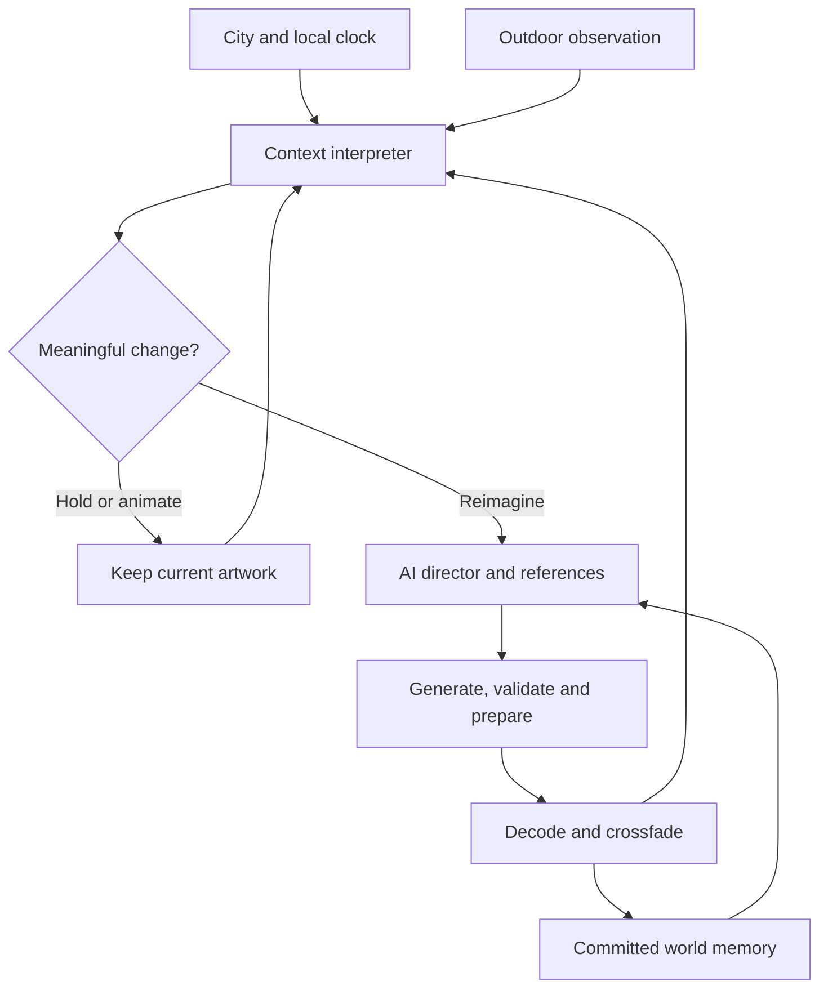

# Heartbeat

**Turn any screen into a living, context-aware piece of art.**

Heartbeat is an experimental ambient display that interprets local time, outdoor temperature and date to create atmosphere. The intended experience is simple: type a city, enter the display, and let a visual world evolve alongside the day.

**Status: working prototype, not the completed product.** The environmental interpreter, browser player and continuity study work. The live AI director and image-generation path are implemented but have not been verified with a configured generation credential. The current main display holds a reference image while adjusting light and motion; it does not yet create fresh artwork autonomously.

Read [PROJECT_VISION.md](PROJECT_VISION.md) for the reasoning behind the product, architecture choices, full scope and long-term direction.

## The intended experience

1. Open Heartbeat and see its name and one city input.
2. Enter a city and resolve its correct location and timezone.
3. Enter an immersive display with artwork, accurate time and outdoor temperature.
4. Let the system reason about time, temperature and date in the background.
5. When a meaningful change warrants it, prepare new artwork without interrupting the current frame.
6. Replace the frame with a gentle transition. Continue without user input.

Date is a reasoning input; the latest product direction keeps only time and temperature visible by default. Name, style and vibe questions, style labels and diagnostic panels are not part of the target opening or ambient display.

**The repository still contains the older interface.** This documentation records the revised direction; it does not imply that the city-only redesign has been implemented.

## What exists today

| Area | Implemented behaviour | Limit or remaining work |
| --- | --- | --- |
| Location | City search resolves coordinates, country and an IANA timezone. | Simplify the opening to the single city input. |
| Time and date | Local formatting uses `Intl`; a server-time offset is used when available. | The current UI displays date and extra labels that must be simplified. |
| Temperature | Open-Meteo supplies local-area outdoor temperature. Server collection has a browser fallback. | It is not an indoor sensor reading. Stale or missing observations must stay visibly unavailable. |
| Context interpretation | Rule-based `HOLD`, `ANIMATE` and `REIMAGINE` decisions use time, temperature, weather, season and existing preference fields. | This baseline is not an LLM. The next default must centre time, temperature and date, without depending on extra setup. |
| Visual response | Brightness, colour, lamp-like warmth and movement respond to context on existing artwork. | Effects cannot replace real semantic scene changes. |
| Frame playback | Current and prepared frame slots, browser image decoding, crossfades, pause/resume and overdue-frame handling. | Cloud-generated playback is implemented but unverified end to end. |
| Persistence | D1 stores profile, displayed/pending frames, pulse history, generation attempts and world memory. | Production recovery, multi-device account ownership and a durable generation queue remain future work. |
| AI direction | A vision-capable director request receives current/canonical images, context, a world identity and recent displayed events. Structured instructions are validated. | Requires a server-side generation credential; no credentialed provider run has been completed. |
| Image generation | Initial generation, subsequent reference-image editing, image checks and R2 storage. | Implemented integration, not a verified live service. |
| Continuity study | `/story` plays six simulated beats through three reference-edited scenes, with stable holds and decoded transitions. | Uses pre-generated artwork and simulated London conditions. It is not live generation. |
| Environmental laboratory | `/pulse` lets a developer simulate conditions using the rule-based interpreter. | Diagnostic surface, not the intended product flow. |
| Screensaver behaviour | Fullscreen control, gently moving artwork, fading controls and best-effort screen wake lock. | Browser ambient mode only. Native OS idle activation and a fully hidden ambient UI are not completed. |

## Why the current cat does not keep changing

The main display uses a pre-generated London window scene as a reference. With live generation disconnected, the server deliberately holds that scene. The clock and temperature continue updating, and atmospheric effects can change, but the subject is not being regenerated.

The separate study demonstrates continuity using a warm morning with the lamp off, a rainy evening with warm lamplight, and a cold night with the same cat under the existing blanket. Those images were generated ahead of time. They demonstrate a visual relationship, not autonomous context-aware synthesis.

The sleeping cat, room and `Cute anime` label are prototype choices, not permanent product requirements. The next iteration must permit new subjects, activities and views while preserving a coherent aesthetic. Keeping the exact room forever is an overconstraint in the current director and memory model.

## Development progress

| Milestone | What was built | What it established |
| --- | --- | --- |
| Initial ambient prototype | Browser display, location search, accurate overlays, reference artwork, preferences and persistent current/pending frames. | A usable display shell; it did not establish the core intelligence. |
| Environmental heartbeat | Rule-based interpretation, context freshness checks, solar phases, mood/effects and saved recent observations. Timer-driven reference rotation was removed. | Meaningful changes can be distinguished from stable conditions. |
| Continuity proof | Reference-edited morning and cold-night assets, a six-beat study, structured scene directions, image-aware director inputs and committed-frame memory. | Related images can evolve visibly and transition without a loading screen in the controlled study. |
| Product correction | Agreed city-only opening, minimal overlays, time/temperature/date-led reasoning and less restrictive continuity. | A documented implementation target. These interface and creative-direction changes are still pending. |

This GitHub snapshot is based on the Site source commit `eab1aa8b9dce64335d471cebdb6d3ac41ca17a67`. The application source is preserved; the README, vision document and export ignore rules document the project for handoff. No product features were implemented as part of this documentation export.

## Architecture

The current implementation uses React 19, TypeScript, Vinext/Vite, Tailwind CSS, Radix/Base UI components, a Cloudflare Worker, D1 and R2.



The diagram describes the intended connected path. Today the context interpreter and reference display run; the AI branch is gated on a configured service and is not verified end to end.

### Heartbeat and cost control

- Local overlays update independently of image generation.
- Weather context is refreshed approximately every five minutes while the page runs.
- Cheap atmospheric interpretation runs approximately every minute.
- Full reimagining is considered on a roughly ten-minute cadence, with advance preparation when appropriate.
- A heartbeat is a decision opportunity, not a promise of a new paid image.
- The live path applies a prototype limit of 24 generation-path attempts per UTC day per world. Failed requests and director-only holds after acquiring an attempt can consume this limit. It is not a subscription allowance.
- A successful live frame increments `moments` only when committed for display.

### World memory

`lib/story.ts` defines a structured world identity, current scene state and up to eight committed frame events. The initial identity is retained, and subsequent frames record changes only when committed for display. Duplicate display requests are guarded, and version checks reject conflicting updates.

This protects continuity, but the existing fixed camera/geometry/inhabitant constraints are too restrictive for the revised vision. Future memory must distinguish lasting aesthetic identity from details that may change naturally, including subject, activity, composition and viewpoint.

### Reliability boundaries

The current browser drives scheduling. Hidden tabs defer work; returning can show an overdue prepared frame without replaying every missed heartbeat. Pausing stops scene progression. Current artwork stays visible during preparation or failure.

The live preparation route uses a five-minute lease, version guards and a generation-attempt cap. It still depends on a foreground HTTP request. It has not been moved to a durable background queue. A browser closing or losing its connection is not yet a fully recovered production workflow.

Before storage, WebP checks cover container integrity, size, static-image status and landscape dimensions. The player decodes a candidate image before replacement. These checks do not establish artistic quality, factual interpretation or visual continuity; automated semantic checks and human quality evaluation remain work to do.

## Routes and source map

| Path | Purpose |
| --- | --- |
| `app/heartbeat.tsx`, `app/ambient.css` | Existing opening, display controls, overlays, atmosphere and player. |
| `lib/context.ts` | City resolution and local outdoor observations. |
| `lib/pulse.ts` | Rule-based environmental interpretation, significance and recent pulse events. |
| `lib/playback.ts` | Playback scheduling decisions. |
| `lib/world.ts` | Domain types, default profile and reference artwork definitions. |
| `lib/story.ts` | Structured directions, world identity and committed-frame memory. |
| `lib/generation.ts` | Optional AI director, image generation/editing, usage recording and storage. |
| `lib/image-check.ts` | WebP structure and dimension validation. |
| `lib/server.ts` | Session cookie, profile validation and D1 access. |
| `app/api/world` | Read or save the cookie-scoped world. |
| `app/api/context`, `app/api/locations` | Local context and city search. |
| `app/api/pulse` | Persist environmental observations and pulse history. |
| `app/api/heartbeat` | Consider and prepare the next live frame. |
| `app/api/display` | Commit a prepared frame with version/idempotency guards. |
| `app/api/art/[id]` | Read generated artwork within the current cookie-scoped world. |
| `app/story`, `lib/continuity.ts` | Pre-generated, simulated continuity study. |
| `app/pulse` | Isolated environmental test laboratory. |
| `db/schema.ts`, `drizzle/` | Storage schema and ordered migrations. |
| `public/art/` | Five bundled generated reference/study images. |
| `docs/continuity-prompts.json` | Exact prompts for the newer reference edits. |
| `build/`, `scripts/`, `vendor/` | Retained runtime/build scaffolding and bundled notices. |

## Running and checking the source

### Requirements

- Node.js satisfying the package engine (`>=22.13.0`); Node 22.18+ or a compatible newer release is recommended for the native TypeScript stripping used by the domain checks.
- The package-manager version pinned by `package.json`: pnpm `11.25.0`.
- A runtime that supports Cloudflare Worker bindings for D1 (`DB`) and R2 (`BUCKET`). This is not a frontend-only static project.

### Local development

From a clone of this repository, install using the checked-in lockfile:

```bash
pnpm install --frozen-lockfile
pnpm dev
```

A clean clone uses the portable execution profile, whose development port is `5173`. The configuration provides local Worker bindings; local database state starts empty. Before using persistent API routes, apply the existing SQL migrations once, in filename order, to the local `DB` binding using the D1 tooling for that runtime. Do not rerun the `ALTER TABLE` migrations against an already migrated database. `pnpm db:generate` generates new migrations from schema changes; it does not apply existing migrations.

The hosted prototype was validated in the managed Sites environment. Clean-clone installation, cross-platform development and independent Cloudflare deployment have not been requalified during this export. If using the retained Linux installer, `pnpm run install:ci` additionally requires Bash, `flock` and GNU `timeout`.

### Checks

```bash
node --experimental-strip-types tests/world.mjs
node --experimental-strip-types tests/pulse.mjs
node --experimental-strip-types tests/story.mjs
pnpm exec tsc --noEmit
pnpm build
```

The three domain check scripts and TypeScript are rechecked for this handoff. The last application build and browser study verification passed during the October 8 implementation milestone. A fresh live-provider test, long soak test and native device qualification have not passed because they have not yet been completed.

The tests cover timezone rollover/DST, playback policy, freshness, solar timing, temperature changes, weather families, hysteresis, hemisphere-aware seasons, stable holds, structured directions, bounded memory, identity retention and bundled WebP validation. Some legacy policy checks remain in `tests/world.mjs`; the active environmental interpretation lives in `lib/pulse.ts`.

### Optional live generation configuration

The current server expects:

| Variable | Meaning |
| --- | --- |
| `OPENAI_API_KEY` | Server-only generation credential. Never commit or expose it to the browser. |
| `HEARTBEAT_DIRECTOR_MODEL` | Director model identifier; current source fallback is `gpt-4.1-mini`. |
| `HEARTBEAT_IMAGE_MODEL` | Image model identifier; current source fallback is `gpt-image-2`. |

These are source defaults, not a claim about current model availability, pricing or account access. Verify the chosen models when activating the service. Configure secrets using the deployment runtime's secret mechanism. The source currently also requires enabling live mode in the existing preferences after the server reports availability; the revised city-only experience should handle this operationally rather than making generation setup a user onboarding choice.

No credential or private runtime data is included in this repository. Without the live connection, local clock/context and reference artwork can work, but autonomous fresh artwork cannot.

### Hosting

`.openai/hosting.json` retains the original Site identity and logical D1/R2 bindings. It is deployment metadata, not a credential. The existing hosted project uses the Sites workflow; copying this repository alone does not create resources or grant deployment access. Do not replace its project ID to publish over another Site. An independent hosting target requires its own runtime configuration and resources.

This export does not redeploy or change the existing Site audience.

## What needs to happen next

1. Replace the opening with `heartbeat` and one city input, and remove style labels, extra setup and diagnostic links from the ambient experience.
2. Make the display visually minimal: artwork, time and temperature, with controls/cursor hidden during inactivity.
3. Revise the director and memory contract so time, temperature and date shape genuinely fresh subjects and activity without freezing the same room forever.
4. Configure a generation service securely and verify the entire real-data-to-new-frame path.
5. Run multiple consecutive autonomous heartbeats, including stable holds, preparation failures and recovery, with no loading gap.
6. Move generation to a durable queue and verify long sessions, browser/device limits and costs before a public service.
7. Test whether people choose to leave it running in their room. Treat retention and atmosphere as the first product evidence.

## Scope, economics and rights

Hardware, advanced news intelligence, payments, subscriptions and business display management are future possibilities, not implemented features. An annual subscription and an allowance of **AI Moments** are hypotheses, not current offers. Ten-minute checks must not be sold as unlimited expensive image generation.

Weather data is provided by [Open-Meteo](https://open-meteo.com/). Review the provider's current attribution, licensing and commercial-use terms before a commercial release. Local context is an outdoor estimate for the selected area, not an exact sensor reading from the user's room.

Bundled artwork was AI-generated for prototype use. Keep the included third-party notices. No project-wide open-source license has been selected by this export; repository visibility does not itself grant an open-source license.
