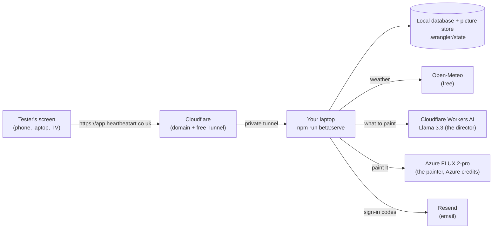

# How Heartbeat works (private test, November 2026)

A plain-English guide to how the pieces fit together, where each one lives, what happens when
someone uses Heartbeat, and what keeps it safe and cheap. For setup steps see
[private-beta.md](private-beta.md); for the deeper engineering record see
[system-design.md](system-design.md).

No keys, passwords or personal email addresses are in this document or anywhere in the repository.
They live only in the ignored `.dev.vars` file on the computer that runs Heartbeat.

## The big picture

In one sentence: a tester's screen talks to **your laptop** through Cloudflare. Your laptop
checks the weather, asks one AI to **decide** a scene and another AI to **paint** it, checks
the picture, stores it, and sends it to the screen.

## The pieces and where they live

| Piece | Where it runs | What it does | Cost |
|---|---|---|---|
| **Heartbeat app** (website + server) | Your laptop, started with `npm run beta:serve` | Everything: sign-in, displays, picture jobs, dashboard | Free |
| **Cloudflare Tunnel** | Windows service on your laptop + Cloudflare | Connects `app.heartbeatart.co.uk` to `localhost:8787` without opening your home network | Free |
| **Domain** `heartbeatart.co.uk` | Cloudflare | The address people type; DNS and email forwarding | Yearly domain fee |
| **Company site** `heartbeatart.co.uk` | Cloudflare Pages | The living hero, journal, principles and Labs (static, separate from the app); Make it yours goes to early access | Free |
| **Database and pictures** | `.wrangler/state` folder on your laptop | Accounts, invites, pictures, watch time, spend | Free |
| **Director** (Llama 3.3 70B) | Cloudflare Workers AI | Reads time, weather, sky, mood and ingredient words; writes the scene and the image prompt | About $0.002 a picture |
| **Painter** (FLUX.2-pro) | Microsoft Azure AI Foundry | Paints the picture (about 15 seconds) | About $0.04 a picture, paid by Azure credits |
| **Weather** | Open-Meteo (free service) | Temperature, rain, cloud; city search | Free for this non-commercial test |
| **Email** | Resend | Sends six-digit sign-in codes from `hello@heartbeatart.co.uk` | Free up to 100 a day / 3,000 a month |

The app is built for Cloudflare's hosting (Workers, D1 database, R2 storage, Workflows). On your
laptop, the same code runs inside Cloudflare's local runtime (workerd), which imitates all four
on your machine. That is why moving to paid Cloudflare hosting later needs no rewrite.

## What happens when a tester signs in

1. You add their email on the dashboard (`/admin`). Only invited emails, plus yours as the owner,
   can sign in. There are 25 places.
2. They open `app.heartbeatart.co.uk/auth` and enter their email.
3. The server makes a random six-digit code, stores only a scrambled (hashed) copy, and emails the
   code through Resend.
4. They type the code. It works once, for 10 minutes, with at most 5 tries; then they must ask for
   a new one. At most 5 codes per email every 10 minutes.
5. On first sign-in their account is created. It is free: no payment, no plan.
6. They get a secure cookie that keeps them signed in for 30 days. Removing them on the dashboard
   ends it immediately.
7. They choose a city once; their display opens.

## What happens when a picture is made

1. **The screen asks.** About once a minute the display checks whether a new picture is due. The
   first one is due straight away; after that, every 10 minutes while the screen is open.
2. **Limits are checked** (see "Money safety" below). If any limit is reached, the current picture
   simply stays.
3. **A job is created.** Each picture is a small "job" saved in the database. It moves through steps
   and survives a restart, so a half-finished picture is picked up again instead of paid for twice.
4. **The moment is read:** local time and date, live weather, the sun's height and direction, the
   moon's phase, cloud cover and the season.
5. **Ingredients are drawn:** one random word from each of seven groups (subject, object, place,
   style, twist, viewpoint, palette), 350 words in all. Recently used words are drawn less often. At
   night only dark palettes are drawn.
6. **The mood is applied:** Auto, Calm, Sleep, Cosy, Focus, Playful, Dreamy or Romantic. Each adds an
   instruction, shifts the colours and twists, and sets a brightness limit. Night darkness always wins.
7. **The director decides.** Cloudflare's Llama 3.3 receives all of that and must reply in a strict
   format: a title, a short reason, the image prompt, the lighting, and which ingredient words it used
   (at least two). A reply that breaks the rules is rejected before anything is painted, at almost no cost.
8. **The painter paints.** Azure FLUX.2-pro paints the prompt in the screen's shape (landscape,
   portrait or wide), about one megapixel.
9. **The picture is checked.** Night and dim moods have a brightness limit. A picture that is too
   bright is dimmed rather than thrown away, so no paid picture is wasted. Exact repeats are rejected.
10. **It is stored** in the local picture store, and the job is marked ready.
11. **The screen shows it.** The display downloads it and cross-fades from the old picture. The
    fade is slower for calm moods.

**Moods:** choosing a mood never starts a picture. It is saved to the account, and the *next*
picture follows it. A picture already being made keeps the old mood.

## Money safety

| Limit | Value | Where to change it |
|---|---|---|
| New picture per screen | every 60 minutes (per tester on the dashboard) | `HEARTBEAT_BETA_CADENCE_MINUTES`, dashboard → Picture pace |
| Pictures per tester per day | 30 (per tester on the dashboard) | `HEARTBEAT_BETA_USER_DAILY`, dashboard → Picture pace |
| Spend for everyone per day | $5 (resets midnight UTC) | `HEARTBEAT_DAILY_BUDGET_MICROS` (5000000 = $5) |
| Attempts for everyone per day | 200 | `HEARTBEAT_AI_DAILY_LIMIT` |
| Testers | 25 | `HEARTBEAT_BETA_SEATS` |

- The $5 cap is checked **before** every paid call, using an estimate of $0.04 per picture and
  $0.002 per director decision. When the next picture would go over, nothing is called.
- A failed picture is never retried automatically in a loop; the screen waits for its next turn.
- Pictures are only made while a screen is open and visible.

## What the dashboard records

The dashboard at `/admin` is visible only to the owner email. To everyone else it looks like the
page does not exist.

- **Watch time:** while a display is open and visible, it reports once a minute. Gaps over
  2.5 minutes (screen hidden, laptop asleep) are not counted. "Watching now" means a report in the last 2 minutes.
- **Per tester:** joined, last seen, sessions, total and average watch time, pictures, current mood, device type.
- **Pictures:** each request with its result, how long it took and, if it failed, where and why.
- **Spend:** today's estimated spend against the cap.
- **Activity:** sign-ins, code requests, attempts by people who are not invited, invites, removals, mood changes.

Testers are told on the sign-in page that screen time is recorded during the test.

## Where data lives

Everything is in `.wrangler/state` inside the project folder on your laptop: accounts, invites,
pictures, watch time, activity and spend. It is **not** in the repository and **not** in the cloud.

- Don't delete that folder; it is the whole database.
- `npm run beta:serve` makes a backup in `outputs/backups` before changing the database structure.
- Deleting a tester from the invite list signs them out but keeps their history for the dashboard.

## Where secrets live

All keys are in `.dev.vars` beside `package.json`. Git ignores this file, so it is never uploaded
to GitHub. When the server starts it copies the file into the build folder (`dist/server/.dev.vars`),
which is also ignored.

| Setting | What it is | Replace it at |
|---|---|---|
| `CLOUDFLARE_ACCOUNT_ID`, `CLOUDFLARE_API_TOKEN` | Workers AI access for the director | Cloudflare → My Profile → API Tokens |
| `AZURE_IMAGE_ENDPOINT`, `AZURE_IMAGE_KEY` | The FLUX.2-pro painter | Azure portal → your AI resource → Keys and Endpoint |
| `HEARTBEAT_EMAIL_API_KEY` | Resend sending key | resend.com → API Keys |
| `HEARTBEAT_OPERATOR_KEY` | Private key the server uses for its every-minute maintenance | Any long random text |
| `KIE_API_KEY` (optional) | The older Kie painter | kie.ai → API keys |

The tunnel's own token is stored by the Cloudflare Tunnel Windows service, not in the project.

If a key is ever exposed (pasted in a chat, shown in a screenshot), replace it at the place above,
update `.dev.vars`, and restart with `npm run beta:serve nobuild`.

## How it stays secure

- **Invite only.** Codes are sent only to invited emails; strangers get nothing.
- **Codes:** random, single-use, 10 minutes, 5 tries, stored hashed, rate-limited.
- **Cookies:** secure, HTTPS-only, not readable by page scripts; 30 days.
- **Requests:** actions are accepted only from the real `app.heartbeatart.co.uk` page, so other websites can't act for a signed-in tester.
- **Your laptop:** the app listens only on the laptop itself (`127.0.0.1:8787`). Nothing on your home
  network or router is opened; only the tunnel reaches it.
- **Keys never reach the browser.** All AI and email calls are made by the server.
- **Owner-only dashboard**, checked on the server on every request.

## When something goes wrong

| What you see | Likely cause | What to do |
|---|---|---|
| Testers get an error page | Laptop asleep, offline, or the server window closed | Wake the laptop and run `npm run beta:serve nobuild`; set Windows sleep to Never while testing |
| "Illustrated preview" stays | The first picture is still being made, the 10-minute wait, or a failure | Dashboard → Recent pictures shows which; PowerShell shows `Heartbeat picture failed` lines |
| No code email | Spam folder, or Resend's 100-a-day limit | Check spam; check Resend → Logs |
| Pictures stop for everyone | The $5 daily cap is reached | Wait until midnight UTC, or raise the cap |
| "This email isn't on the invite list" | Not invited, or a typo | Add the exact email on the dashboard |

## The Windows app

A tester downloads Heartbeat from their studio and opens it once. It installs into their own user
folder, becomes the screensaver, starts with Windows, and signs in with the same email code. When the
computer is idle, the screensaver shows the newest picture full-screen with the time and
temperature, and asks the server for new pictures **only while it is showing**. Moods, city and
account stay on the website; the icon by the clock offers mood and pause shortcuts. It checks once a
day for a newer version and updates itself. Details: [clients/windows/README.md](../clients/windows/README.md);
the contract every app follows: [api-for-apps.md](api-for-apps.md).

## The Android app

Downloaded from the studio (a 40 KB file; testers allow "install unknown apps" once). After signing in
with the email code it can be the lock screen picture and home screen wallpaper (refreshed about every
30 minutes, at most one new picture an hour, only while the screen is on), Android's screensaver while
charging, or a full-screen "frame" that keeps the screen on. Details: [clients/android/README.md](../clients/android/README.md).

## The Mac app

A menu-bar app (`clients/mac`, Swift, about 200 KB, Apple silicon and Intel, macOS 13+). First run asks:
wallpaper, full-screen when idle, start at login. It keeps the newest picture as the wallpaper,
shows Heartbeat full-screen after the chosen idle time (but not while a video or call keeps the
display awake), keeps the display on while plugged in, and offers mood, pause, timing and studio from
the menu bar. It is signed ad hoc (free) but not notarised, so macOS asks once (System Settings →
Privacy & Security → Open Anyway). Built automatically on GitHub's free Mac runners.

## iPhone and iPad

Apple doesn't allow apps outside the App Store without a paid developer account, so Heartbeat uses
two free, built-in routes: **Add to Home Screen** (the display opens full-screen and keeps the screen
on), and a **private picture link** for a Shortcuts automation that sets the lock screen every hour.
The link can only fetch the newest picture, is one per person, is rate limited, and is turned off by
creating a new one or disconnecting it in the studio.

## The website

The app address opens the public website (`components/public-site.tsx`): animated home with real
pictures and moods, downloads for every device, help (`/download`), FAQ, terms and privacy. The
owner dashboard (`/admin`) is refused on the server for everyone but the owner. Every page and API
reply carries security headers (no framing, no type sniffing, strict referrer, HTTPS only).

## Moving to paid hosting later

When the test has proven the idea, the same code can run on Cloudflare's own servers (Workers Paid,
about $5 a month): no laptop to keep awake, a real cloud database and storage, and automatic
every-minute maintenance. Changes then: create the cloud database and storage, move the keys
into Cloudflare's secret store, switch to a commercial weather plan, and turn on payments when
ready. The private-test switches (`HEARTBEAT_BETA`, `HEARTBEAT_SELF_HOSTED`) are then turned off.

## Map of the code

| Area | Files |
|---|---|
| Sign-in codes, invites, tracking, dashboard data | `lib/product/beta.ts` |
| Sign-in page | `components/code-sign-in.tsx` |
| Dashboard page | `app/admin/`, `components/admin-dashboard.tsx` |
| Screen watch-time reports | `hooks/use-presence.ts` |
| Picture jobs (steps, limits, recovery) | `lib/product/jobs.ts`, `lib/product/usage.ts` |
| Director rules and prompts | `lib/director-contract.ts`, `lib/creative.ts` |
| Ingredients, moods, sky | `lib/ingredients.ts`, `lib/moods.ts`, `lib/sky.ts` |
| Painters | `lib/ai/azure-flux.ts`, `lib/ai/kie.ts`, `lib/ai/cloudflare.ts` |
| Night brightness check | `lib/ai/night-quality.ts` |
| Weather | `lib/server/weather.ts` |
| The display | `app/live-heartbeat.tsx`, `components/ambient-art.tsx`, `components/mood-picker.tsx` |
| Running on your laptop | `scripts/beta-serve.mjs`, `scripts/beta-setup.mjs`, `lib/product/self-hosted.ts` |
| API for installed apps | `lib/product/app-api.ts`, [api-for-apps.md](api-for-apps.md) |
| Windows app | `clients/windows/Heartbeat.cs`, `scripts/build-windows.mjs` |
| Android app | `clients/android/`, `scripts/build-android.mjs` |
| Mac app | `clients/mac/`, `.github/workflows/mac.yml` |
| Website | `components/public-site.tsx`, `components/site-pages.tsx`, `app/site.css` |
| Owner-only page guard, security headers | `lib/product/owner-page.ts`, `lib/product/security-headers.ts` |
| Database changes | `drizzle/` (newest: `0015_beta.sql`) |
