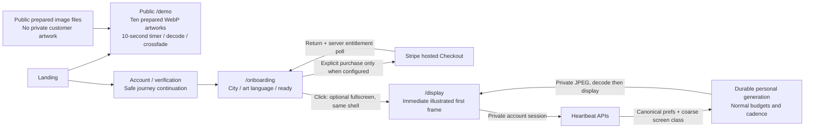
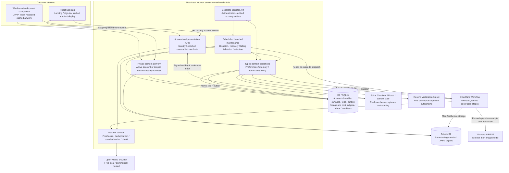
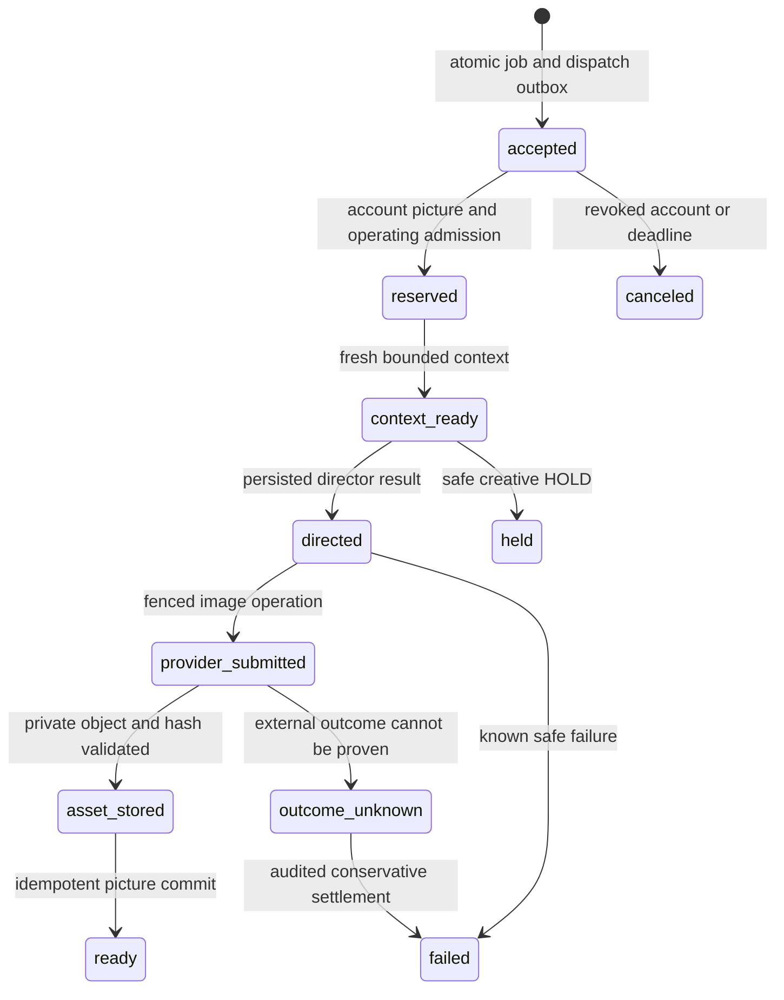
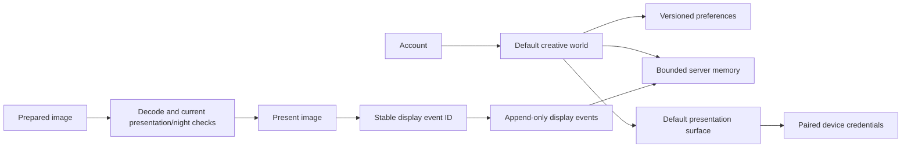
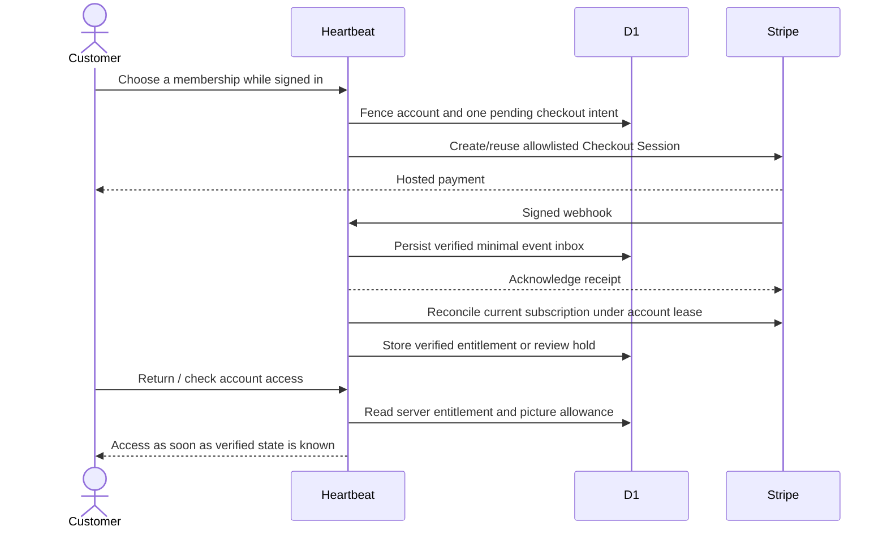

# Heartbeat: current system design

Updated 27 October 2026 against the local architecture implementation. The code supports the following design; hosted production and third-party acceptance remain unqualified. See [requirement coverage and remaining gates](architecture-changes.md) and [operator setup](launch-setup.md).

## Customer entry and recording mode

Authentication supports a Heartbeat password and an optional Google OpenID Connect client. The Google authorization-code flow keeps client credentials server-side, uses PKCE and one-use state, validates signed Google ID tokens and binds the stable Google subject to an account. Existing unverified accounts require a signed-in user to link Google; a Google-only user can set a Heartbeat password from a recent Google session. Google account setup and real consent/login testing remain operator steps. Email verification and reset need configured delivery; the local operator can issue a one-use reset link through `npm run account:recover` without altering cloud data.

The recording route needs no account, email or payment configuration. It loads all ten original prepared images before starting and makes no account, weather, billing or inference requests during playback. Its weather/time labels are recorded examples, with a persistent prepared-demo label. It does not alter normal generation cadence, personal history or the three-attempt local operating safeguard. Original PNGs and optimized WebPs are versioned under `public/demo/art`; prompts/provenance are in `docs/demo-art-a.json` and `docs/demo-art-b.json`.

Personal onboarding saves canonical preferences with version checks, preserves a selected plan through authentication/email links, and enters the ambient player without a navigation that would discard the fullscreen gesture. Fullscreen still requires a user click and browser support. Paid-plan previews remain unavailable while billing is disabled; no return URL grants membership.

The authenticated surface endpoint records normalized aspect/resolution classes using ownership, lifecycle and version checks. Unchanged classes cause no database writes. Resize publication is debounced and never requests generation. New director packets use the screen class for composition and crop safety; the current model output is not a native 4K/portrait-resolution promise. Default surfaces remain shared across an account; independent device surfaces and native mobile apps are future work.

The weather adapter uses manual redirects because Workerd rejects `redirect: 'error'`. Redirect responses fail without being followed. A typed upstream outage may fall back to known time/season with weather explicitly unknown; configuration and unexpected failures still fail closed. Provider 400/401/403/404 responses are configuration failures, without retries or stale-weather substitution. Customer/hosted browsers cannot bypass this adapter with a free-provider fallback; that fallback is limited to the noncustomer HTTP-loopback study. Real Workerd and React regression tests cover these boundaries.

## System and trust boundaries

The artwork-first interface remains React/TypeScript through Vinext/Vite. `build/sites-worker.ts` exposes the HTTP handler, scheduler and Workflow class. HTTP, scheduled maintenance and Workflow entry all validate runtime configuration/schema. The framework is beta and needs hosted qualification.

Provider keys never go to the browser or native client. Customers create an account and receive its entitlements. Existing private images can be retrieved without a current paid plan, provided the account/device remains valid and the manifest is ready. Retrieval is `private, no-store`; there are no public bucket URLs or cross-account image caches.

The landing uses curated examples, so visiting it does not request inference. Earlier world/story/pulse/study routes require explicit development opt-in on HTTP loopback. They are not an alternative production inference route.

## Generation, recovery and creative state

Each account/request ID maps to one job. The job and outbox share a D1 transaction; loss of immediate dispatch does not lose the intent. Stable Workflow IDs and scheduled repair close the dispatch/acknowledgement gap. Each stage checks its lease, version and account credential epoch before committing. Queue deadlines, one pending account job, provider slots and circuits bound work; this is basic admission fairness, not a premium-tier scheduling algorithm.

Provider operations have stable keys and separate reservation/submission/settlement records. After an ambiguous external response, recovery first looks for a valid persisted object/result. It does not automatically buy the same inference again. An unresolved outcome remains explicit for an operator; this is not an exactly-once provider guarantee.

New artwork has an immutable owner/job key and manifest with content hash, dimensions and validation version. Recovering an R2 success does not require another paid image call. Routine retention protects current images, favourites and active/unknown work. A deletion claim rechecks those protections before removing bytes. Account deletion revokes access immediately, then retries bounded cleanup, including late writes after revocation.

The server resolves generation inputs from canonical preferences and memory. Clients cannot replace creative history with a submitted snapshot. Preference saves use an expected version; stale writes return a conflict. Display and feedback events update memory under a version claim. A generated/downloaded image does not enter displayed history until a valid acknowledgement. Lost ACK responses can be retried with the same event ID.

Default world/surface records establish future boundaries; customer-managed multiple worlds, independent device surfaces and phone applications are not implemented. The browser refreshes account identity/version on focus, visibility, storage changes and periodically. Native caches are namespaced by origin, account and surface. Offline copies cannot be remotely erased instantly.

## Payment to access

Returning from Checkout never grants a plan by itself. The return path requests reconciliation and briefly polls, so a delayed webhook need not wait for a browser reload. The signed event is stored before acknowledgement; background and scheduled processing repair retries. The pinned Stripe request/webhook contract is `2025-03-31.basil`; incompatible signed events are quarantined for review. Unknown Prices cannot grant paid access. Refund/dispute holds require audited resolution; a later invoice does not silently clear them.

Real access should update promptly after verified payment, but webhook delivery, provider availability and reconciliation take time. The UI represents a confirming state. Actual sandbox timing and lifecycle remain to be tested. Membership eligibility, remaining pictures, shared operating budget and provider capacity are separate checks; a paid plan does not bypass safety ceilings.

Account deletion cannot race an open/confirming Checkout or a live checkout/reconciliation lease. Cancel/resolve checkout and subscriptions first. This prevents an in-flight financial operation from losing its account association.

## Credentials and environment separation

| Value | Development | Hosted target | Customer receives it? |
| --- | --- | --- | --- |
| Cloudflare account ID / inference token | Ignored `.dev.vars` | Isolated runtime secret | No |
| Deploy token | Not needed for local use | GitHub environment `DEPLOY_CLOUDFLARE_TOKEN` | No |
| Weather key | Free local adapter needs none | Environment `WEATHER_API_KEY`, sent only server-to-provider | No |
| Resend key / verified sender | Optional local email test | `EMAIL_API_KEY` / `EMAIL_FROM` | No |
| Google OAuth client | Optional local sign-in test | `GOOGLE_CLIENT_ID` / `GOOGLE_CLIENT_SECRET` | No (ID is public to Google; secret stays server-side) |
| Stripe secret / webhook signing secret | Separate sandbox setup | Isolated test/live runtime secrets | No |
| Stripe Price IDs | Nonsecret operator configuration | Distinct allowlisted prices per target | Displayed price data only |
| Operator recovery key | Optional ignored local setting | Separate `OPERATOR_KEY` secret | No |
| Account/device session | HTTP-only cookie / DPAPI-scoped token | Hashed server record, expiry and credential epoch | Its own session only |
| Old display access key | Explicit local study only | Disabled customer/hosted path | No |

`config/environments.json` contains distinct target resource names and deliberately unusable placeholder IDs/origins with zero monetary budget. It contains no real secrets. `scripts/release-config.mjs` rejects missing isolation or unapproved operating settings. Each target explicitly sets `billingEnabled`, currently false. The release workflow requires protected GitHub environments, a reviewed exact commit and, for production, a successful staging release of that same commit plus recorded acceptance. It uploads code and secrets together; activation validates required Stripe fields, distinct Prices and environment-appropriate key modes before migrations. Staging rejects live keys. Resources, reviewers, secret configuration and actual release runs are still operator setup. Stripe provisioning was explicitly skipped for this demo.

## Operations and evidence limits

The scheduler independently runs bounded dispatch, stage repair, billing inbox/reconciliation, account deletion and retention. One failed maintenance domain does not stop the others. Operator endpoints expose aggregate status, audited unknown settlement, billing retry/review resolution, exact-period picture allowance adjustments and bounded maintenance. They require a separate bearer secret and an actor/reason for mutations. Allowance adjustments are idempotent, cannot withdraw reserved/used units, and never rewrite image history or provider spend. Logs/aggregates are implemented; a monitoring destination, SLOs, a support interface and invoice-based cost reconciliation remain to be configured or built.

The weather adapter preserves observation/fetch timestamps and provider provenance. Its bounded cache, in-flight deduplication and circuit are isolate-local. Hosted weather routes require account admission; free local requests are limited to explicit HTTP loopback development. Commercial access is required by hosted policy, and no subscription was purchased by this work.

Local tests establish contracts and recovery behavior under controlled SQLite/mocked service failures. They do not establish hosted throughput, real Stripe/email delivery, provider economics, visual quality, native Windows behavior or mobile OS support. [The acceptance record](architecture-changes.md) lists every remaining release gate.
