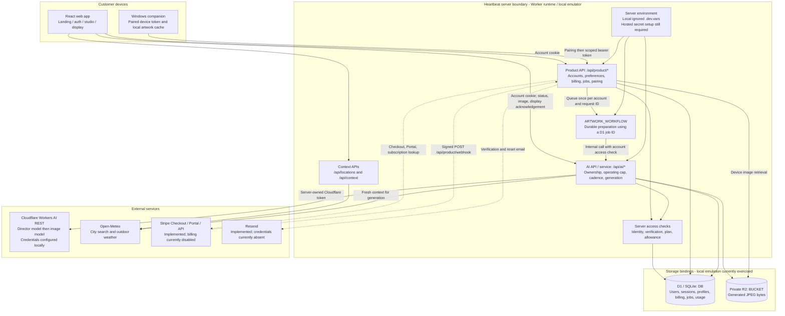
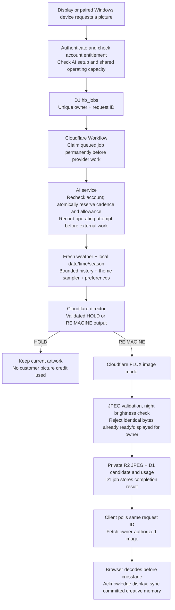

# Heartbeat: current system design

Verified against this checkout on 22 October 2026. This is an implementation map, not a diagram of an already deployed commercial service. The diagrams describe existing code; disabled integrations are labelled explicitly. Source publication does not deploy Heartbeat or enable billing.

## 1. The account and credential model

Customers sign in to Heartbeat. They do not supply or receive Cloudflare, Stripe or email-provider keys. Heartbeat's backend uses the operator's credentials to serve authorized accounts. Payment changes an account's stored entitlement, not which API key is sent to the customer.

An account session identifies the user. Server-side checks then determine their verified-email status, subscription, picture allowance and cadence. A separate shared operating budget and provider availability can still prevent generation. Existing private pictures remain retrievable by their owner without requiring an active paid plan.

## 2. Overall architecture



Notes:

- Solid connections are implemented paths exercised locally to varying degrees; they do not certify hosted capacity. Dashed connections are the implemented email/billing integrations that remain unconfigured locally and unqualified with real services.
- React/TypeScript runs through Vinext/Vite with App Router conventions. `build/sites-worker.ts` exposes the HTTP handler and Workflow class. `vite.config.ts` configures `DB`, `BUCKET` and `ARTWORK_WORKFLOW` bindings for local emulation/build output. Hosted resource provisioning and secret configuration are separate work.
- The landing uses curated illustrative assets. Opening it does not call an image model. `/local-study` and `/prototype/` are earlier free experiments; older world/story APIs are not the current customer architecture.
- The Windows companion uses revocable account-paired credentials, not provider keys. Its binaries are unsigned and still need native OS qualification. No native phone client or installable PWA has been implemented.
- APIs enforce ownership before reading private images. R2 credentials are not returned to the browser; the Worker reads through its bucket binding.

## 3. Exactly how a subscription unlocks access

This flow is implemented but currently inactive because billing is disabled and Stripe configuration is missing locally.

```mermaid
sequenceDiagram
    actor Customer
    participant Web as Heartbeat web app
    participant API as Heartbeat server
    participant Stripe
    participant DB as D1 account and billing records

    Customer->>Web: Choose Studio or Atelier
    Web->>API: POST /api/product/checkout with plan
    API->>API: Authenticate; require verified email and billing config
    API->>Stripe: Validate configured monthly Price; create/reuse customer
    API->>DB: Save customer mapping and checkout idempotency record
    API->>Stripe: Create/reuse hosted Checkout Session
    API-->>Web: Hosted Checkout URL
    Web->>Stripe: Navigate to hosted Checkout
    Customer->>Stripe: Complete subscription checkout
    Note over Web,Stripe: The browser return and webhook may arrive in either order
    Stripe-->>Web: Return to /app?billing=success
    Stripe->>API: Signed event to /api/product/webhook
    API->>API: Verify signature and timestamp; check duplicate event
    API->>DB: Acquire fenced account reconciliation lease
    API->>Stripe: Fetch current subscriptions for mapped customer
    API->>DB: Atomically save plan/status/period/review flag and event ID
    API-->>Stripe: Acknowledge successfully processed event
    loop Every 5 seconds, for up to 60 seconds after return
        Web->>API: GET /api/product/auth/session
        API->>DB: Read billing and count account picture usage
        API-->>Web: Current plan, allowance and eligibility
    end
    Web-->>Customer: Show confirmed membership, or delayed-confirmation message
```

Important details:

1. **No manual per-customer activation is intended.** Once a valid subscription is reconciled, the backend immediately uses the new entitlement on its next access check. The current checkout-return UI notices it on its next five-second poll. This is event-driven activation, not a guaranteed zero-delay payment-to-access promise.
2. **A success URL cannot grant access.** Editing `?billing=success` or requesting an expensive plan from the browser does not update the server entitlement. The server selects an allowlisted Stripe Price and binds the Checkout to the authenticated customer's account.
3. **Stripe is checked on the server.** The webhook reads current subscription state rather than trusting the event's old payload to overwrite newer billing state. Event IDs, a fenced per-account lease and atomic persistence handle duplicates, concurrency and retries. Failed reconciliation returns an error for delivery retry.
4. **Paid access has explicit conditions.** `accessFor` requires a mapped Studio/Atelier plan, `active` or `trialing` status, an unexpired billing period and no review flag. Verified email and remaining allowance are required for generation. Refund/dispute events persist a review requirement. Other subscription states fall back to trial policy. This is the current implementation; commercial grace-period/refund policy still needs approval and real-provider testing.
5. **Activation and image readiness are different.** A paid member can become entitled before their first original finishes. New generation also needs AI enabled/configured, the Workflow binding, available operating budget, account cadence and provider availability. Existing artwork remains during preparation or failure.
6. **Current UX recovery is limited.** The return page stops polling after one minute and explains the delay. Other already-open tabs are not pushed subscription updates through WebSockets/SSE. Periodic server billing reconciliation and a support/admin recovery tool are not implemented. Do not promise uninterrupted instant activation before the real delivery/retry/recovery paths are qualified.

Stripe also requires server-side fulfillment rather than relying solely on a customer returning to the landing page: [Checkout fulfillment guidance](https://docs.stripe.com/checkout/fulfillment).

## 4. Artwork generation and display



Notes:

- Customer web requests use `/api/product/generation`; Windows refresh uses `/api/product/device/refresh`. The job calls the common AI preparation service internally. The older direct `/api/ai/prepare` route remains in source and uses the same authorization/accounting service; it is not the customer player's durable-job submission route.
- Jobs recover by account/request ID; ambiguous funded requests are polled rather than blindly submitted again. The Workflow has no automatic step retries around paid preparation. This reduces duplicate spending but does not guarantee exactly-once provider execution or refunds after an interrupted call.
- Pending customer jobs poll on a separate five-second schedule while the display is active. Normal AI status refresh is once per minute while visible, and on return to visibility. This job polling is separate from the five-second checkout-confirmation polling.
- New work is triggered by clients. No server scheduler proactively prepares artwork for closed apps or sleeping phones. A job already submitted to the Workflow is designed to survive the browser closing; local emulation does not prove hosted reliability.
- Local rules create the baseline; the runtime model selects a validated direction from context and inspiration. History and fingerprints encourage variety. Identical-image rejection is not proof that every composition is semantically unique.
- Failed/HOLD work does not consume a customer picture credit. Reserved work temporarily counts toward the account allowance; a successful prepared image counts even before display and after later retention expiry. Every recorded preparation, including failures/HOLDs, remains spent against the shared operating cap.
- Memory is bounded scene/creative data, not an unbounded chat transcript. Customer profiles/preferences/memory are saved in D1; browser storage provides optional local continuity and recovery. The server also stores attempt metadata and generated-image ownership. Routine image expiry is best effort during successful preparation; general scheduled cleanup remains missing.

## 5. Where keys and configuration are now

**Local file:** `.dev.vars` at the repository root, next to `package.json`. It is ignored by Git. `.env.example` is the tracked placeholder template, not an active credential store. Values were not copied into this document.

Presence below describes this checkout only, as inspected on 22 October 2026. It does not prove credentials are valid, services have capacity, or a hosted deployment has the same configuration.

| Name / resource | Purpose | Current local state | Customer receives it? |
| --- | --- | --- | --- |
| `CLOUDFLARE_API_TOKEN` | Server REST calls to director and image models | Configured in ignored `.dev.vars` | No |
| `CLOUDFLARE_ACCOUNT_ID` | Select operator Cloudflare account; an identifier, not a secret | Configured in ignored `.dev.vars` | Not needed |
| `HEARTBEAT_AI_ACCESS_KEY` | Older local-study shared-key session | Present in ignored `.dev.vars`; production rejects shared-key login | No customer setup requirement |
| `HEARTBEAT_EMAIL_API_KEY` | Resend verification/reset delivery | Absent from local `.dev.vars` | No |
| `HEARTBEAT_EMAIL_FROM` | Approved sender address; not a secret | Absent from local `.dev.vars` | Sender address appears in emails |
| `STRIPE_SECRET_KEY` | Server calls to Stripe | Absent from local `.dev.vars` | No |
| `STRIPE_WEBHOOK_SECRET` | Verify the particular endpoint's Stripe events | Absent from local `.dev.vars` | No |
| `STRIPE_STUDIO_PRICE_ID`, `STRIPE_ATELIER_PRICE_ID` | Map allowed Stripe Prices to plans; identifiers, not secrets | Absent from local `.dev.vars` | Not credentials |
| `DB`, `BUCKET`, `ARTWORK_WORKFLOW` | Worker storage/job bindings | Configured for local emulation/build; hosted provisioning unqualified | No storage/job credentials |
| Account session / paired device token | Authenticate a particular customer or authorized device | Issued at login/pairing; hashes stored server-side | Yes, only their own scoped credential |

Local flags currently are `HEARTBEAT_APP_MODE=development`, `HEARTBEAT_AI_ENABLED=true`, `HEARTBEAT_BILLING_ENABLED=false` and `HEARTBEAT_AI_DAILY_LIMIT=3`. Explicit development bypasses email verification only on HTTP loopback. It is not production access policy.

For hosting, configure the real secrets in the target Worker's server-side secret storage and ensure both HTTP and Workflow execution receive the required environment. Configure origins, model names, sender/Price IDs and other nonsecret settings separately. Local `.dev.vars` is not automatically a deployed secret store, and pushing source to GitHub does not configure cloud services. See [Cloudflare secret configuration](https://developers.cloudflare.com/workers/configuration/secrets/).

The current adapter uses Cloudflare REST with the operator's token, rather than a Workers AI `AI` binding. D1/R2/Workflow access uses bindings rather than exposed customer storage keys. The historical OpenAI world generator is not the active customer image path.

## 6. Storage and code ownership

| Concern | Current storage | Code to inspect |
| --- | --- | --- |
| Users, hashed passwords/sessions, expiring verification/reset tokens | `hb_users`, `hb_sessions`, `hb_tokens`, `hb_rate` | [`auth.ts`](../lib/product/auth.ts), [`service.ts`](../lib/product/service.ts) |
| Preferences and bounded creative memory | `hb_profiles` | [`service.ts`](../lib/product/service.ts), [`ambient-director.ts`](../lib/ambient-director.ts), [`creative.ts`](../lib/creative.ts) |
| Subscription, customer mapping, checkout reuse, processed events | `hb_billing`, `hb_checkout`, `hb_events` | [`billing.ts`](../lib/product/billing.ts), [`access.ts`](../lib/product/access.ts) |
| Account-owned background requests | `hb_jobs` | [`jobs.ts`](../lib/product/jobs.ts), [`workflow.ts`](../lib/product/workflow.ts) |
| Cadence, attempts, candidate metadata, ownership, image hash/key | `ai_sessions`, `ai_attempts`; private JPEG in R2 | [`AI service`](../lib/ai/service.ts), [`Cloudflare adapter`](../lib/ai/cloudflare.ts) |
| Favourites and Windows pairing | `hb_likes`, `hb_devices` | [`service.ts`](../lib/product/service.ts), [`devices.ts`](../lib/product/devices.ts), [`desktop source`](../desktop/Heartbeat.cs) |
| Checkout-return status polling | Browser state; server entitlement remains authoritative | [`customer-app.tsx`](../components/customer-app.tsx) |
| Context and playback | Server context collection; browser display lifecycle | [`context.ts`](../lib/context.ts), [`use-ai-playback.ts`](../hooks/use-ai-playback.ts), [`live-heartbeat.tsx`](../app/live-heartbeat.tsx) |

Draft plans in [`core.ts`](../lib/product/core.ts) remain trial 3 lifetime / Studio 120 per billing month / Atelier 360 per billing month, with 60/30/10-minute minimum generation intervals. Both paid tiers currently use the same models. The local shared three-attempt UTC-day cap can block even a paying account with unused allowance: it must be replaced or deliberately configured for a measured operating budget before accepting customers.

## 7. Activation and scale gaps

Before live paid access, complete real email delivery, HTTPS staging, isolated hosted resources/migrations/secrets, Stripe sandbox Checkout/Portal/webhook lifecycle tests and hosted Workflow qualification. Test payment with the browser closed, delayed/duplicate/out-of-order events, temporary API/database failures, renewal, cancellation, failed payment and refund/dispute review. Check that entitlement changes do not depend on a browser redirect.

There is no demonstrated large-user capacity. Measure concurrency, database queries/status writes, queue delay, provider latency, inference/storage/delivery cost and hosted CPU/memory. Add budget/concurrency controls, periodic reconciliation, scheduled cleanup, monitoring/alerts, backup/restore and support/admin recovery. A successful local automated test is not a capacity guarantee.

Phone clients can reuse the account and generation backend after device authentication/delivery work. They also need portrait composition, caching and battery/lifecycle design; automatic preparation while closed needs server scheduling. Native wallpaper integration and store billing require platform-specific work and policy qualification. No diagram node above represents a completed mobile application.

See [the activation guide](product-build.md) for operator steps and [the project vision](../PROJECT_VISION.md) for product priorities. This documentation update does not change application behaviour, activate paid services or raise operating limits.
